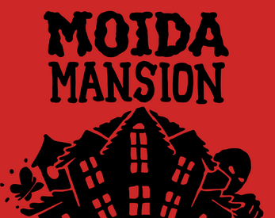

# Moida Mansion — PortMaster Edition

[](https://portmaster.games/)
[](https://pyga.me/)
[-orange.svg)](https://dukope.itch.io/moida-mansion)
[](LICENSE)

An authentic, native retro LCD handheld port of Lucas Pope's (*Papers, Please*, *Return of the Obra Dinn*) **Moida Mansion**, tailored specifically for Linux retro handheld consoles (R36S, Anbernic RG351/RG353, Powkiddy RGB30/RGB20S, TrimUI, etc.) running **ArkOS**, **dArkOSen**, **AmberELEC**, **JELOS**, or **ROCKNIX** via PortMaster.



> [!NOTE]
> This repository contains the open-source PortMaster wrapper, custom vector polygon renderer, audio synthesizer, and launcher scripts. In accordance with PortMaster guidelines and copyright, the original game logic (`moida.js`), comic manual (`manual.png`), and device artwork (`hardware.jpg`, `glass.jpg`) are **not** bundled and must be obtained for free from Lucas Pope's official itch.io page.

---

## Features

* **Authentic Vector LCD Rendering**: High-precision SVG polygon rendering reproduces every authentic segment, custom font glyph, and sprite animation from the original release at native 640×480 resolution.
* **Vintage LCD Simulation**:
  * **Fullscreen LCD Mode (Default)**: Maximizes the LCD screen across the entire handheld display for maximum clarity.
  * **Framed Bezel Mode**: Plays inside the authentic red plastic handheld shell with textured glass when `hardware.jpg` is provided (auto-crops and fits the screen at launch).
  * **Glass Glare Reflection**: Toggle subtle or vintage physical glass light reflection when `glass.jpg` is provided.
  * **Ghost Segments**: Optional faint display of unlit LCD segments, simulating real-life passive LCD panels under ambient light.
* **Piezo Audio Synthesizer**: Pure real-time procedural square-wave sound synthesizer that replicates the distinctive frequency sweeps and chirps of 1980s piezo buzzers without audio underruns.
* **12-Page Comic Instruction Booklet**: View the authentic 12-page manual at any time in-game with instant game-pausing when `manual.png` is provided.
* **Pause & Options Menu**: Press `START` to freeze gameplay and adjust display and audio settings on the fly.
* **Rock-Solid Handheld Controls**: Customized single-event controller pipeline tuned for the R36S and PortMaster handhelds with zero double-input glitches or skipped lines.

---

## Controls

### In-Game (Playing)

| Button | Action |
| :--- | :--- |
| **D-Pad Left / Right** | Walk through door into adjacent room (Left / Right) |
| **D-Pad Up** or **X Button** | Climb Stairs (Move through floors) |
| **D-Pad Down** or **B Button** | Search furniture & cycle searchable objects in room |
| **START Button** | Pause game and open the **Pause & Options Menu** |
| **SELECT Button** | Pause game and open the **12-Page Instruction Manual** |
| **SELECT + START** | Universal PortMaster Quick Exit to EmulationStation |
| *Y, A, L1, R1, L2, R2* | *Disabled during gameplay* |

---

### In the Pause & Options Menu

| Button | Action |
| :--- | :--- |
| **D-Pad Up / Down** | Navigate menu options (1 line per click) |
| **D-Pad Left / Right** | Adjust setting values (*Display Mode, Ghost Segments, Glare, Sound*) |
| **B Button** | Select / Confirm highlighted item (*Resume, Manual, Controls, Quit*) |
| **START Button** | Resume gameplay immediately |

---

### In the Instruction Manual

| Button | Action |
| :--- | :--- |
| **D-Pad Right** | Flip to next page sequentially (1 → 2 → 3...) |
| **D-Pad Left** | Flip to previous page sequentially |
| **B Button** | Exit manual and resume gameplay |
| **START / SELECT** | Also exits manual and resumes gameplay |

---

## Installation Guide

Setting up the port takes only 2 minutes:

### Step 1: Install Port Files
1. Go to the **[Releases](../../releases)** tab on GitHub and download the zip that matches your setup:
   * **`moidamansion.zip`** (**32.4 MB** — *Standard*): Slim package for handhelds with PortMaster / Wi-Fi.
   * **`moidamansion-offline.zip`** (**61.8 MB** — *Standalone*): Complete package pre-bundled with universal Pygame-CE runtime for offline handhelds without Wi-Fi.
2. Extract the contents directly to the `ports/` directory on your handheld console's SD card:
   ```text
   SD Card /
   └── roms /
       └── ports /  (or just ports/ depending on your firmware)
           ├── Moida Mansion.sh
           └── moidamansion /
               ├── main.py
               ├── engine.js
               ├── moidamansion.gptk
               ├── port.json
               ├── gamedata /
               │   └── PUT_GAME_FILES_HERE.txt
               └── ...
   ```

### Step 2: Add Free Game Assets from Itch.io
Visit Lucas Pope's official game page:  
👉 **[dukope.itch.io/moida-mansion](https://dukope.itch.io/moida-mansion)**

Place the following files into `ports/moidamansion/gamedata/`:

| File | Status | Description | How to get from itch.io |
| :--- | :--- | :--- | :--- |
| **`moida.js`** | **Required** | Game logic engine | Save page (`Ctrl + S`) or inspect game frame |
| **`manual.png`** | *Optional* | 12-page comic manual booklet | Right-click the comic booklet on page → Save image |
| **`hardware.jpg`** | *Optional* | Red handheld plastic casing bezel | Save from game assets (or `hardware_jpg.jpg`) |
| **`glass.jpg`** | *Optional* | Acrylic screen reflection glare | Save from game assets (or `glass_jpg.jpg`) |

*(The port automatically recognizes both original itch.io filenames like `moida_i9Qw.js`, `02wPJo_R3Nl.png`, `hardware_jpg.jpg`, `glass_jpg_i9Qw.jpg` and clean names!)*

> [!TIP]
> If you only provide `moida.js`, the port will run in crisp **Fullscreen LCD Mode** by default. Adding `hardware.jpg` automatically enables the **Framed Bezel** option in the Pause Menu!

### Step 3: Play!
Put the SD card back into your handheld, refresh your game list in EmulationStation, and launch **Moida Mansion** under Ports!

---

## Technical Architecture

* **Engine Core**: Headless bridge running the original compiled game logic in Node.js via standard POSIX IPC.
* **Frontend**: Custom rendering and audio engine built with [Pygame-CE](https://pyga.me/) (Python 3.12).
* **PortMaster Integration**: Uses PortMaster's squashfs runtime mounting system (`pygame-ce_2.5.6_python_3.12.8_gzip.squashfs`) with universal gzip compatibility across ArkOS and dArkOSen kernels.

---

## Credits & License

* **Moida Mansion Game Design, Code, and Art**: © [Lucas Pope](https://dukope.itch.io/) / [3909 LLC](https://3909.org/). All rights reserved. Play the original game for free at [dukope.itch.io/moida-mansion](https://dukope.itch.io/moida-mansion).
* **PortMaster Port & Pygame-CE Frontend**: Created by the community. Licensed under the [MIT License](LICENSE).
